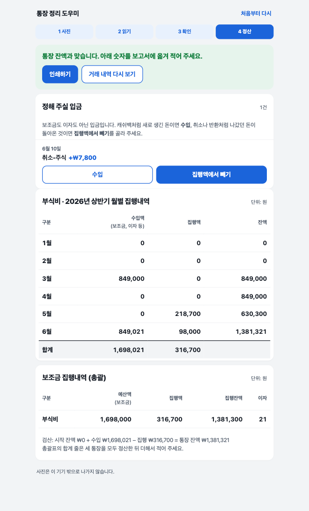
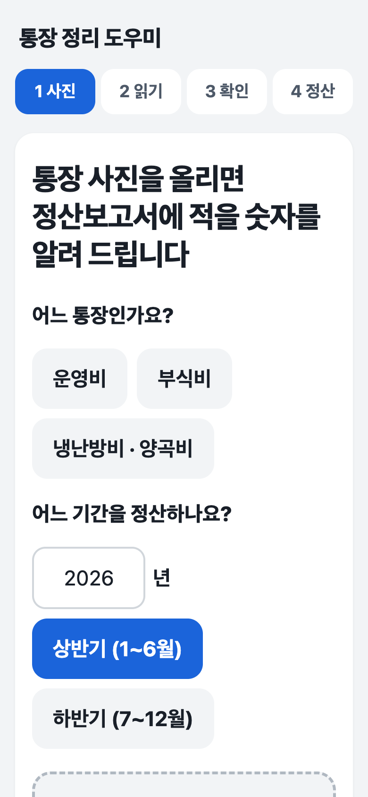
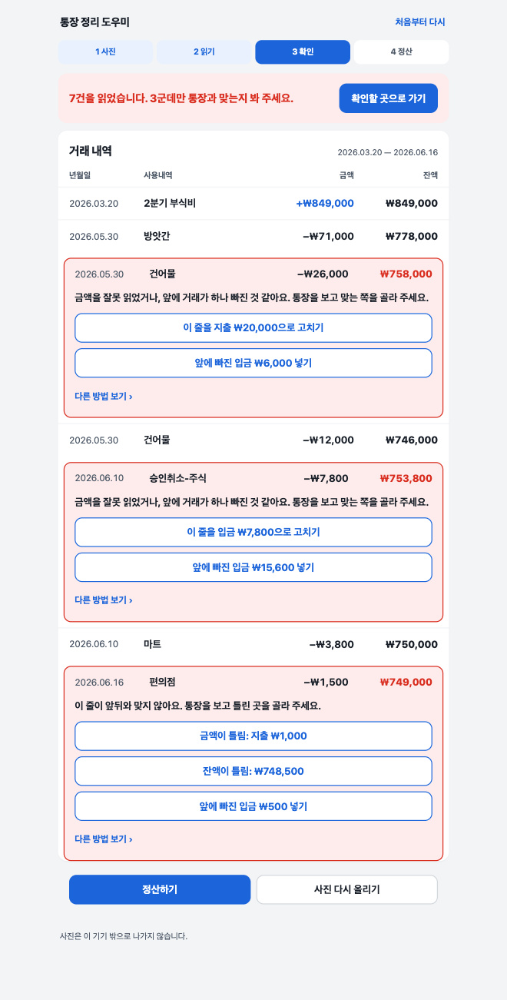

[日本語](README.md) | **한국어**

# 경로당 통장 정리 도우미

경로당 통장 사진을 찍으면, 잔액이 맞는지 한 줄씩 검산한 뒤 **구청에 내는 보조금 정산보고서에 옮겨 적을 숫자**를 알려 주는 웹 앱입니다. 보고서는 어르신이 직접 쓰고, 이 앱은 칸에 들어갈 숫자만 맞게 만들어 드립니다.

<p align="center">
  
</p>

## 왜 만들었나

할머니가 경로당 회계를 맡고 계십니다. 경로당은 보조금 항목마다 통장을 따로 쓰고(운영비 · 부식비 · 냉난방비), 반년마다 6개월치 정산보고서를 써서 구청에 냅니다.

종이 통장에는 보조금 입금, 물건값 출금, 결산이자, 캐쉬백, 카드 승인취소가 한데 섞여 찍힙니다. 이걸 손으로 나눠 더하다 보니 계산이 헷갈리고, 오래 걸리고, 금액이 틀리는 일이 생겼습니다.

## 하는 일

1. **사진 올리기**: 통장(운영비 / 부식비 / 냉난방비·양곡비)과 기간(상반기 / 하반기)을 고르고 통장 사진을 올립니다. 사진 순서는 상관없고, 겹쳐 찍어도 됩니다.
2. **읽기**: 사진에서 거래를 읽고, 잔액을 근거로 페이지 순서를 맞춰 이어 붙입니다.
3. **확인하기**: `앞 잔액 + 입금 − 출금 = 잔액`이 깨지는 줄을 찾아, 원인과 고칠 값을 제안합니다.
4. **정산하기**: 보고서의 두 표(월별 집행내역, 총괄)에 들어갈 숫자를 보여줍니다. 검산이 맞기 전에는 숫자를 보여주지 않습니다.

| 사진 올리기 (휴대폰) | 확인하기 |
|:---:|:---:|
|  |  |

## 설계에서 지킨 것

**틀린 답을 자신 있게 내놓지 않는다.** 회계에서는 모른다고 말하는 편이 안전합니다.

- **잔액 항등식으로 스스로 검산합니다.** 통장의 모든 줄은 `앞 잔액 + 입금 − 출금 = 잔액`을 만족해야 합니다. 깨지는 줄은 다음 줄을 보고 원인을 가립니다.
  - 고친 잔액으로 다음 줄이 맞으면 → **잔액을 잘못 읽음**. 맞는 잔액을 제안합니다.
  - 찍힌 잔액으로 다음 줄이 맞으면 → **금액을 잘못 읽었거나 거래 한 줄이 빠짐**. 숫자만으로는 둘을 가를 수 없어, 두 가지 고치는 방법을 함께 보여주고 통장을 보고 고르게 합니다.
  - 둘 다 아니면 → **확인 필요**. 억지로 단정하지 않습니다.
- **모르는 입금은 사람에게 넘깁니다.** 입금은 보조금 / 이자 / 미정으로 나눕니다. 보조금은 `분기`와 그 통장의 항목 이름이 함께 있어야 인정합니다. 운영비 통장에 들어온 "2분기 냉난방비"처럼 애매한 입금이나 캐쉬백, 승인취소는 미정으로 남기고, 사람이 **수입** 또는 **집행액에서 빼기**를 고릅니다. 어느 쪽을 골라도 장부 등식은 깨지지 않습니다.
- **사진 순서도 잔액이 정합니다.** 각 페이지의 시작 잔액(첫 거래를 되돌린 값)이 앞 페이지의 끝 잔액과 맞물리는 순서로 잇습니다. 겹쳐 찍은 구간은 이음새에서만 잘라내서, 같은 날 같은 가게에서 같은 금액을 두 번 쓴 정상 거래는 지우지 않습니다.
- **OCR 잡음은 확실한 것만 고칩니다.** `₩`를 `*`로, `0`을 `O`로 읽는 것처럼 기계적으로 확실한 오독만 고치고, 애매한 숫자는 검산에 맡깁니다.

## 정산 규칙

| 보고서 칸 | 계산 |
|---|---|
| 월별 수입액 | 그달의 보조금 + 이자 + "수입"으로 정한 미정 입금 |
| 월별 집행액 | 그달의 출금 합계 − "집행액에서 빼기"로 정한 미정 입금 |
| 월별 잔액 | 그달 말 통장 잔액 (거래가 없는 달은 앞 달 잔액) |
| 총괄 예산액 | 이월금(앞 반기에서 넘어온 잔액) + 그 반기 보조금 |
| 총괄 집행잔액 | 예산액 − 집행액 |
| 총괄 이자 | 결산이자 합계 |

총괄표에 칸이 없는 수입(캐쉬백 등)은 따로 알려 줍니다.

## 개인정보

- 기본 OCR 엔진은 **EasyOCR(로컬 추론)**입니다. 통장 사진이 이 컴퓨터 밖으로 나가지 않습니다.
- 서버는 올린 사진을 메모리에서만 다루고 디스크에 저장하지 않습니다.
- 이 저장소의 예시 데이터는 계좌번호 · 예금주 · 거래처 이름을 가명으로 바꾼 것입니다. 실제 통장 사진은 저장소에 없습니다.

## 실행

```bash
cd backend
pip install -r requirements.txt
pip install easyocr            # 실제 사진을 읽을 때만 필요 (첫 실행 때 한국어 모델을 내려받습니다)
uvicorn server:app --reload
```

브라우저에서 <http://127.0.0.1:8000>을 엽니다. 사진 없이 **사진 없이 둘러보기**로 데모 데이터를 볼 수 있습니다.

### API

| 요청 | 하는 일 |
|---|---|
| `GET /api/review` | 데모 검토 데이터 |
| `POST /api/review` | 통장 사진 여러 장 → OCR → 병합 → 검토 결과 (`시작잔액` 포함) |
| `POST /api/settlement` | 검토를 마친 거래 + 통장 · 연도 · 반기 · 미정 입금 결정 → 정산보고서 값 |

### 테스트

```bash
cd backend
pip install httpx              # 서버 테스트용
python3 -m pytest -q
```

## 구조

```
backend/
  server.py              FastAPI 서버
  ocr/                   사진 → 텍스트 줄 (EasyOCR, 줄 복원, 잡음 정리)
  passbook/
    lines.py             텍스트 줄 → 거래
    pages.py             여러 장을 잔액으로 이어 붙이기, 시작 잔액 추정
    review.py            잔액이 안 맞는 줄의 원인과 고칠 값
    classify.py          입금 → 보조금 / 이자 / 미정
    settlement.py        반기 정산값 (월별 · 총괄 · 검산)
  tests/
frontend/index.html      화면 (빌드 없이 파일 하나)
```

## 한계

- 실제 통장 한 세트(통장 3개, 사진 6장)로 확인한 결과, 거래 줄을 정확히 읽은 비율은 통장마다 100% / 79% / 16%였습니다. 가장 낮은 통장은 글자는 대체로 읽지만 **여러 거래가 한 줄로 합쳐지는**(줄 복원) 문제가 있습니다. 이때는 잔액 검산이 깨져 정산이 완료되지 않으므로 틀린 숫자가 보고서로 넘어가지는 않습니다.
- 다른 은행의 통장 인쇄 형식은 확인하지 않았습니다.
- 로컬 EasyOCR은 CPU에서 사진 한 장에 수 분이 걸립니다.
- 사진이 크게 기울면 줄을 제대로 나누지 못합니다(기울기 보정 없음).
- 총괄표의 세 통장 합계 줄은 통장마다 정산한 뒤 직접 더해야 합니다.
