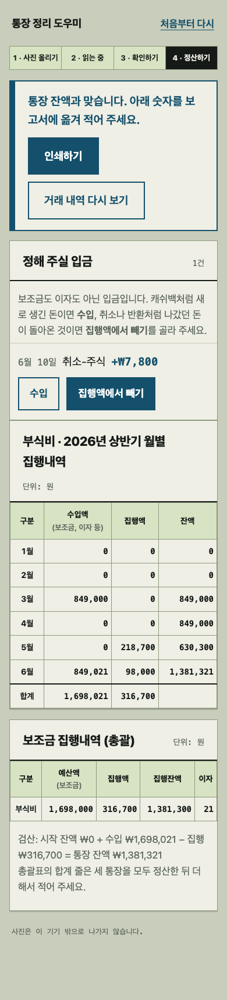
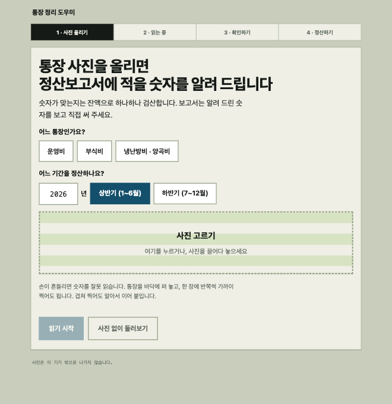

**日本語** | [한국어](README.ko.md)

# 敬老堂 通帳整理アシスタント

敬老堂（韓国の地域の高齢者向け集会所）の通帳を撮影すると、残高が合っているかを一行ずつ検算したうえで、**区役所に提出する補助金精算報告書に書き写す数字**を示すWebアプリです。報告書はご本人が手で書き、このアプリは各欄に入る数字を正しく揃えることだけを担います。

<p>
  
  
</p>

## 作った理由

祖母が敬老堂の会計を担当しています。敬老堂では補助金の項目ごとに通帳を分けて使い（運営費・副食費・冷暖房費）、半年ごとに6か月分の精算報告書を区役所に提出します。

紙の通帳には、補助金の入金、買い物の出金、決算利息、キャッシュバック、カードの承認取消が混ざって印字されます。これを手で分けて合計するうちに計算が混乱し、時間がかかり、金額を間違えることがありました。

## できること

1. **写真のアップロード**：通帳（運営費 / 副食費 / 冷暖房費・糧穀費）と期間（上半期 / 下半期）を選び、通帳の写真をアップロードします。写真の順番は問わず、重ねて撮っても構いません。
2. **読み取り**：写真から取引を読み取り、残高を手がかりにページの順番を揃えてつなげます。
3. **確認**：`前の残高 + 入金 − 出金 = 残高` が崩れる行を見つけ、原因と修正値を提案します。
4. **精算**：報告書の2つの表（月別執行内訳、総括）に入る数字を表示します。検算が合うまでは数字を表示しません。

| 確認 | 写真のアップロード |
|---|---|
|  |  |

## 設計で守ったこと

**間違った答えを自信ありげに出さない。** 会計では「わからない」と言うほうが安全です。

- **残高の恒等式で自ら検算します。** 通帳のすべての行は `前の残高 + 入金 − 出金 = 残高` を満たすはずです。崩れる行は、次の行を見て原因を見分けます。
  - 直した残高で次の行が合う → **残高の読み違い**。正しい残高を提案します。
  - 印字された残高で次の行が合う → **金額の読み違い、または取引1行の欠落**。数字だけでは区別できないため、2つの直し方を並べて示し、通帳を見て選んでもらいます。
  - どちらでもない → **要確認**。無理に断定しません。
- **判断できない入金は人に任せます。** 入金は補助金 / 利息 / 未定に分けます。補助金と認めるのは、`分期（四半期）` とその通帳の項目名が両方あるときだけです。運営費の通帳に入った「2分期 冷暖房費」のような曖昧な入金や、キャッシュバック、承認取消は未定として残し、人が **収入** か **執行額から差し引く** かを選びます。どちらを選んでも帳簿の等式は崩れません。
- **写真の順番も残高で決めます。** 各ページの開始残高（最初の取引を巻き戻した値）が前のページの最終残高とかみ合う順につなげます。重なった区間はつなぎ目でだけ切り取るので、同じ日に同じ店で同じ金額を2回使った正常な取引は消しません。
- **OCRのノイズは確実なものだけ直します。** `₩` を `*` と、`0` を `O` と読むような機械的に確実な誤読だけを直し、曖昧な数字は検算に任せます。

## 精算ルール

| 報告書の欄 | 計算 |
|---|---|
| 月別 収入額 | その月の補助金 + 利息 + 「収入」とした未定の入金 |
| 月別 執行額 | その月の出金合計 − 「執行額から差し引く」とした未定の入金 |
| 月別 残高 | その月末の通帳残高（取引のない月は前月の残高） |
| 総括 予算額 | 繰越金（前の半期から持ち越した残高） + その半期の補助金 |
| 総括 執行残額 | 予算額 − 執行額 |
| 総括 利息 | 決算利息の合計 |

総括表に欄のない収入（キャッシュバックなど）は別途表示します。

## 個人情報

- 既定のOCRエンジンは **EasyOCR（ローカル推論）** です。通帳の写真はこのコンピューターの外に出ません。
- サーバーはアップロードされた写真をメモリ上だけで扱い、ディスクに保存しません。
- このリポジトリの例示データは、口座番号・名義・取引先名を仮名に置き換えたものです。実際の通帳写真はリポジトリにありません。
- NAVER CLOVA OCR との連携コードもありますが、使うと写真が外部に送信されるため、既定では使いません。

## 実行

```bash
cd backend
pip install -r requirements.txt
pip install easyocr            # 実際の写真を読むときだけ必要（初回実行時に韓国語モデルをダウンロード）
uvicorn server:app --reload
```

ブラウザで <http://127.0.0.1:8000> を開きます。写真がなくても **사진 없이 둘러보기**（写真なしで見てみる）でデモデータを確認できます。画面は韓国語です。

### API

| リクエスト | 内容 |
|---|---|
| `GET /api/review` | デモの確認データ |
| `POST /api/review` | 通帳の写真（複数枚）→ OCR → 結合 → 確認結果（`시작잔액`＝開始残高を含む） |
| `POST /api/settlement` | 確認済みの取引 + 通帳・年度・半期・未定入金の判断 → 精算報告書の値 |

### テスト

```bash
cd backend
pip install httpx              # サーバーのテスト用
python3 -m pytest -q
```

## 構成

```
backend/
  server.py              FastAPI サーバー
  ocr/                   写真 → テキスト行（EasyOCR / CLOVA、行の復元、ノイズ整理）
  passbook/
    lines.py             テキスト行 → 取引
    pages.py             複数枚を残高でつなげる、開始残高の推定
    review.py            残高が合わない行の原因と修正値
    classify.py          入金 → 補助金 / 利息 / 未定
    settlement.py        半期の精算値（月別・総括・検算）
  tests/
frontend/index.html      画面（ビルド不要のファイル1つ）
```

## 制約

- 実際の通帳1セット（通帳3冊、写真6枚）で確認した結果、取引行を正確に読めた割合は通帳ごとに 100% / 79% / 16% でした。最も低い通帳では、文字はおおむね読めているものの、**複数の取引が1行にまとまってしまう**（行の復元）問題があります。この場合は残高の検算が崩れて精算が完了しないため、間違った数字が報告書に渡ることはありません。
- 他の銀行の通帳の印字形式は未確認です。
- ローカルのEasyOCRはCPUで写真1枚に数分かかります。
- 写真が大きく傾いていると、行をうまく分けられません（傾き補正なし）。
- 総括表の3冊合計の行は、通帳ごとに精算したあと手で足す必要があります。
